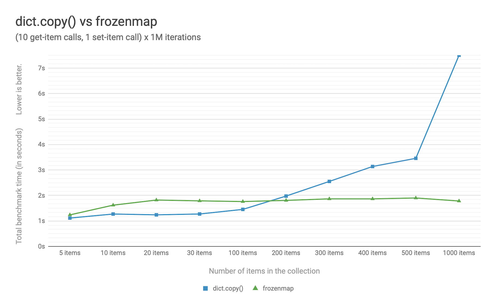

PEP: 603
Title: Adding a frozenmap type to collections
Version: $Revision$
Last-Modified: $Date$
Author: Yury Selivanov <yury@magic.io>
Status: Draft
Type: Standards Track
Content-Type: text/x-rst
Created: 10-Sep-2019
Python-Version: 3.9
Post-History:

Abstract
========

This PEP proposes to add a new immutable mapping type called
``frozenmap`` to the ``collections`` module.

The bulk of the reference implementation is already used in CPython
to implement the ``contextvars`` module.

Rationale
=========

Python has two immutable collection types: ``tuple`` and
``frozenset``.  They can be used to represent immutable lists and sets,
but there is no way to represent immutable *mappings*.

The proposed ``frozenmap`` type implements the
``collections.abc.Mapping`` protocol, supports pickling, and provides
an API for efficient mutation.

A few examples where having an immutable mapping is desirable:

* Immutable mappings are hashable. This makes it is possible to use
  them as dictionary keys or set elements.

  This means that functions decorated with ``@functools.lru_cache()``
  can accept immutable mappings as arguments (passing a plain ``dict``
  to such a function results in error.)

* Immutable mappings can hold complex state that can be copied by
  reference.  That enables efficient implementation of transactional
  mutation of state.

* Immutable mappings can be used to safely share dictionaries across
  thread & asynchronous task boundaries.

Lastly, the main portion of the C code required for the ``frozenmap``
implementation is already part of CPython [1]_.  It is used to
implement the ``contextvars`` module (see :pep:`567` for more details.)
Exposing that code via a public collection type drastically
increases the number of users of that code.  That helps with
discovering bugs and improving performance which otherwise would
be very challenging because most programs use ``contextvars``
indirectly.

Specification
=============

A new public type ``frozenmap`` is added to the ``collections``
module.

Construction
------------

``frozenmap`` implements a ``dict``-like construction API:

* ``frozenmap()`` creates a new empty mapping;

* ``frozenmap(**kwargs)`` creates a mapping from ``**kwargs``, e.g.
  ``frozenmap(spam='ham', foo=42)``

* ``frozenmap(collection)`` creates a mapping from the passed
  ``collection`` object, which can be: a ``dict``, another
  ``frozenmap``, an object with ``items()`` method that is expected
  to return a series of key/value tuples, or an iterable of
  key/value tuples.

Data Access
-----------

``frozenmap`` implements the ``collection.abc.Mapping`` protocol,
therefore getters, membership checks, and iteration work the same
way that would for a ``dict``::

  m = frozenmap(foo='bar')

  assert m['foo'] == 'bar'
  assert m.get('foo') == 'bar'
  assert 'foo' in m

  assert 'baz' not in m
  assert foo.get('baz', 'missing') == 'missing'

  assert m == m
  assert m != frozenmap()

  # etc.

Mutation
--------

``frozenmap`` instances are immutable.  That said it is possible
to efficiently produce mutated copies of them in various ways.

frozenmap.set(key, value)
^^^^^^^^^^^^^^^^^^^^^^^^^

The method allows to assign a value to a key::

  m = frozenmap(foo=1)
  m2 = m.set('bar', 100)

  print(m)   # will print frozenmap({'foo': 1})
  print(m2)  # will print frozenmap({'foo': 1, 'bar': 100})

frozenmap.delete(key)
^^^^^^^^^^^^^^^^^^^^^

The method allows to produce a copy of the ``frozenmap`` without
a key::

  m = frozenmap(foo=1, bar=100)

  m2 = m.delete('foo')

  print(m)   # will print frozenmap({'foo': 1, 'bar': 100})
  print(m2)  # will print frozenmap({'bar': 1})

  m3 = m.delete('spam')  # will throw a KeyError('spam')

frozenmap.update(mapping, \*\*kw)
^^^^^^^^^^^^^^^^^^^^^^^^^^^^^^^^^

The method allows to produce a copy of the ``frozenmap`` with
multiple key/values added.  The signature of the method matches
the signature of the ``frozenmap`` constructor::

  m = frozenmap(foo=1)

  m2 = m.update({'spam': 'ham'})
  print(m2)  # will print frozenmap({'foo': 1, 'spam': 'ham'})

  m3 = m.update(foo=100, y=2)
  print(m3)  # will print frozenmap({'foo': 100, 'y': 2})

  print(m)   # will print frozenmap({'foo': 1})

frozenmap.mutate()
^^^^^^^^^^^^^^^^^^

The method allows to apply multiple mutation operations in an
efficient way.  The ``mutate()`` method returns a new object
``collections.MapMutation`` which implements the full
``collections.abc.MutableMapping`` API.

In

  m = frozenmap(foo=1, spam='ham')

  mut = m.mutate()
  mut[10] = 100
  mut.pop('foo')
  mut['xxx'] = 1

  m2 = mut.finish()  # returns a new `frozenmap` instance

  print(m)   # will print frozenmap({'foo': 1, 'spam': 'ham'})
  print(m2)  # will print frozenmap({'spam': 'ham', 10: 100, 'xxx': 1})

  # it is illegal to mutate `mut` after the `finish` method is called:
  mut[42] = 42  # will throw a ValueError

Iteration
---------

As ``frozenmap`` implements the standard ``collections.abc.Mapping``
protocol, so all expected methods of iteration are supported::

  assert list(m) == ['foo']
  assert list(m.items()) == [('foo', 'bar')]
  assert list(m.keys()) == ['foo']
  assert list(m.values()) == ['bar']

Iteration, unlike in ``dict``, does not preserve the insertion order.

Hashing
-------

``frozenmap`` instances can be hashable just like ``tuple`` objects::

  hash(frozenmap(foo='bar'))  # works
  hash(frozenmap(foo=[]))     # will throw an error

Typing
------

It is possible to use the standard typing notation for frozenmaps::

  m: frozenmap[str, int] = frozenmap()

Implementation
==============

The proposed ``frozenmap`` type uses Hash Array Mapped Trie (HAMT)
data structure. This novel data structure is used in functional
programming languages like Clojure to efficiently implement
immutable hash tables.

HAMT
----

The key idea used in the design of HAMT is that for a pair of *key* /
*value*, the hash of the *key* can be used to determine the exact
position of *value* in the hash map tree.

Immutable mappings implemented with HAMT have O(log N) performance
for ``set()`` and ``get()`` operations.  That is possible because
mutation operations only affect one branch of the tree, making it
possible to reuse non-mutated branches, therefore avoiding copying.

Read more about HAMT in [5]_.  The CPython implementation [1]_ has a
fairly detailed description of the algorithm as well.

Performance
-----------

   Figure 1.  Benchmark code can be found here: [3]_.

The above chart demonstrates that:

* ``frozenmap`` implemented with HAMT displays near O(1) performance
  for all benchmarked dictionary sizes.

* ``dict.copy()`` becomes less efficient around 100-200 items.

.. figure:: pep-0550-lookup_hamt.png
   :align: center
   :width: 100%

   Figure 2.  Benchmark code can be found here: [4]_.

Figure 2 compares the lookup costs of ``dict`` versus a HAMT-based
immutable mapping.  HAMT lookup time is ~30% slower than Python dict
lookups on average.

Design Considerations
=====================

Why "frozenmap" and not "FrozenMap"
-----------------------------------

All lower-case "frozenmap" resonates well with the ``frozenset``
built-in as well as with types like ``collections.defaultdict``.

Why "frozenmap" and not "frozendict"
------------------------------------

"Dict" has a very specific meaning in Python:

* it's a concrete implementation of ``abc.MutableMapping`` with
  O(1) get and set operations (``frozenmap`` has O(log N) complexity);

* Python dicts preserve insertion order.

The proposed ``frozenmap`` does not have the above mentioned
properties: it has an O(log N) cost of set/get operations and it only
implements the ``abc.Mapping`` protocol.

Implementation
==============

The full implementation of the proposed ``frozenmap`` type is
available at [2]_.  The package includes C and pure Python
implementations of the type.

See also the HAMT collection implementation as part of the
CPython project tree here: [1]_.

References
==========

.. [1] https://github.com/python/cpython/blob/3.8/Python/hamt.c

.. [2] https://github.com/MagicStack/immutables

.. [3] https://gist.github.com/1st1/be5a1c10aceb0775d0406e879cf87344

.. [4] https://gist.github.com/1st1/dbe27f2e14c30cce6f0b5fddfc8c437e

.. [5] https://en.wikipedia.org/wiki/Hash_array_mapped_trie#cite_note-bagwell-1

Copyright
=========

This document has been placed in the public domain.

..
   Local Variables:
   mode: indented-text
   indent-tabs-mode: nil
   sentence-end-double-space: t
   fill-column: 70
   coding: utf-8
   End:
